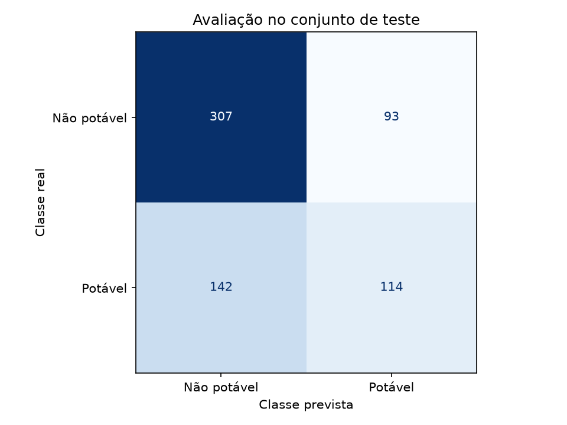

# Resultados das execuções

As duas execuções utilizaram o mesmo CSV, semente 42, divisão estratificada de 2.620 amostras para treinamento e 656 para teste e cinco folds de validação. A alteração planejada entre as execuções foi a quantidade de árvores da Random Forest. O teste foi reservado para a avaliação do modelo selecionado em cada execução.

## Validação cruzada

| Candidato | F1 médio | Desvio padrão | ROC AUC médio |
|---|---:|---:|---:|
| Referência estratificada | 0,4063 | 0,0129 | 0,5038 |
| Regressão logística | 0,4155 | 0,0283 | 0,4768 |
| Random Forest — 100 árvores | 0,5500 | 0,0199 | 0,6956 |
| Random Forest — 200 árvores | 0,5439 | 0,0263 | 0,6951 |

A Random Forest apresentou o maior F1 médio entre os candidatos de cada execução. Dobrar a quantidade de árvores não melhorou a média da validação. Não foi feita busca de hiperparâmetros nem ajuste baseado nas métricas do teste.

## Versões registradas no MLflow

Modelo: `water-potability-classifier`.

| Versão | Árvores | Acurácia no teste | Precisão classe 1 | Recall classe 1 | F1 classe 1 | ROC AUC |
|---|---:|---:|---:|---:|---:|---:|
| 1 | 100 | 0,6311 | 0,5327 | 0,4453 | 0,4851 | 0,6611 |
| 2 | 200 | 0,6418 | 0,5507 | 0,4453 | 0,4924 | 0,6627 |

O alias `selecionado` aponta para a versão 2 por ser a última execução. Ele não indica superioridade à versão 1; pela média da validação, a configuração de 100 árvores foi ligeiramente melhor. As diferenças no teste são apresentadas para documentar as execuções, sem orientar novos ajustes.

## Matriz de confusão da versão 2

| Classe real / prevista | Não potável | Potável |
|---|---:|---:|
| Não potável | 307 | 93 |
| Potável | 142 | 114 |

O modelo acertou 421 das 656 amostras. Classificou 93 amostras não potáveis como potáveis e deixou de identificar 142 amostras potáveis. O desempenho no teste é inferior ao observado na validação; isso limita a capacidade de generalização demonstrada. Estes resultados atendem ao exercício de treinamento e versionamento, mas não sustentam o uso do modelo para decidir sobre consumo de água.

## Evidências

- [Versão 1: resumo e identificação do run](405d2fcb23e84a169519a8bc618155a3/summary.json).
- [Versão 2: resumo e identificação do run](1bcda2bd8afa406ebc48c0f01a6ffad8/summary.json).
- [Versão 2: relatório por classe](1bcda2bd8afa406ebc48c0f01a6ffad8/classification_report.json).
- [Versão 2: resultados da validação](1bcda2bd8afa406ebc48c0f01a6ffad8/validation.csv).
- [Versão 2: previsões do teste](1bcda2bd8afa406ebc48c0f01a6ffad8/test_predictions.csv).
- [Exemplo de predição com a versão 1](predicoes_v1.csv).
- [Exemplo de predição pelo alias](predicoes.csv).

Cada subpasta também contém os índices das partições. As mesmas evidências, os parâmetros e o pipeline completo podem ser consultados no MLflow.